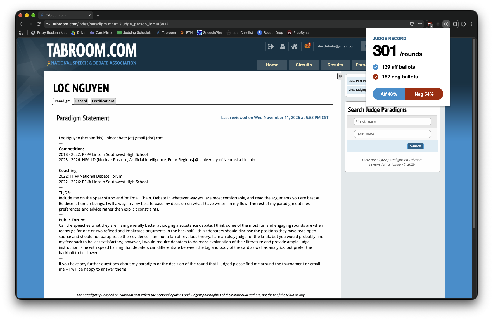

# Tablytics

A Chrome extension to examine how many rounds a judge has judged on [Tabroom](https://www.tabroom.com/index/index.mhtml), a speech and debate tournament management system, alongside their affirmative/negative voting percentages.

## Installation

Load the extension in developer mode:

1. Clone or download this repository.
2. Go to `chrome://extensions` and turn on **Developer mode**.
3. Click **Load unpacked** and select `tablytics-extension`.
4. Pin Tablytics so the extension stays in your toolbar.

## Usage

1. Open a judge's paradigm page on Tabroom.
2. Click the Tablytics icon.

  

*Note: If the page was already open when you installed the extension, reload it first*.

## How it works

A content script runs on Tabroom, specifically when you navigate to paradigms (`tabroom.com/index/paradigm.html`). When you open the extension, it asks the content script for statistics. The content script finds the judging record table of the particular judge (`#judgerecord`), locates the **Vote** column by its header, and counts the ballots.

Everything runs locally in your browser. Tablytics doesn't collect, store, or send any data, and it makes no extra requests to Tabroom.

## Disclaimer

This is an independent hobby project and is not affiliated with Tabroom.com or the National Speech & Debate Association. I am an NSDA alumni and former collegiate competitor who coaches and judges debate competitions regularly.
